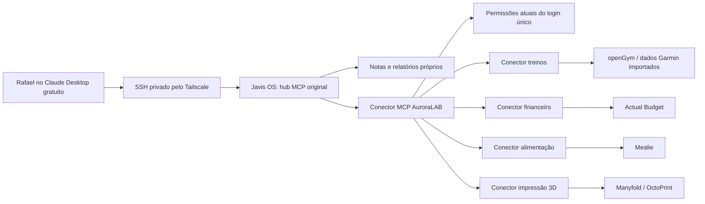

# Javis OS no AuroraLAB — 34.0.0

## Execução com Claude gratuito

Esta instalação usa o Javis OS original 0.623.0, commit `38cc59499c7bb18b50324b1789a32a3a53a1a7dd`. A imagem oficial amd64 está fixada por digest em `docker/server/javis/source.lock.json`; seis arquivos críticos são conferidos durante o build. A interface e o hub são do projeto original. O overlay AuroraLAB adiciona SSO, isolamento, conectores e a ponte privada para o Claude Desktop.

O Claude gratuito não oferece a autenticação Claude Code/API exigida pelo chat interno do Javis. Nesta modalidade, a conversa acontece no **Claude Desktop do Windows**, usando o MCP local do aplicativo, sujeito aos limites gratuitos da Anthropic. Nenhuma API paga ou modelo local é configurado. O chat interno e terminais WebSocket estão desativados. O Javis web organiza as próprias notas e conexões; sua interface nativa oferece inglês e vietnamita e recebeu uma orientação em português.

Os resultados consultados e autorizados no Claude Desktop são enviados à Anthropic para gerar a resposta. Os bancos inteiros não são montados no Javis. Senhas dos aplicativos ficam somente nos respectivos conectores e nunca são devolvidas ao modelo. O Claude não fica executando no servidor nem gera relatórios sozinho com o computador desligado. Esta ponte não habilita a conversa no navegador ou iPhone: o MCP local depende do Claude Desktop e do Tailscale no Windows. Não há Funnel nem endpoint MCP público.

## Containers e permissões

| Serviço | Responsabilidade | Acesso |
| --- | --- | --- |
| javis | Interface e MCP Hub originais | Rede interna, próprios dados/notas, sem Docker socket |
| javis-mcp | Catálogo e despacho de ferramentas | Identidades e permissões vigentes na autenticação central |
| javis-fitness | Resumo de treinos | openGym, somente consulta |
| javis-food | Receitas e listas | Mealie, somente consulta |
| javis-print | Biblioteca e estado da impressão | Manyfold e OctoPrint, somente consulta |
| javis-finance | Contas e totais do período | SDK oficial Actual, cache próprio e consulta |

Contêineres sem privilégios, limites de memória/processos, código em leitura e segredos separados. O Javis tem apenas rede interna, sem saída para provedores de IA. Os conectores precisam alcançar as redes dos aplicativos correspondentes; sua implementação só expõe operações fixas. Não há ferramentas para shell, navegação arbitrária, iniciar impressão ou gravar transações/receitas/treinos.

O painel Javis exige o administrador protegido `aurora@server.local` e a permissão portal. Não há segundo login: o adaptador cria uma sessão nativa no backend após validar o segredo do gateway. Cookies enviados pelo navegador não escolhem o perfil. O endpoint interno de permissões não fica disponível no portal público. Revogações dos aplicativos são consultadas novamente a cada listagem/chamada das ferramentas AuroraLAB.

## Ferramentas disponíveis

- `aurora_fitness_summary`: período de até 366 dias, últimos treinos com duração/calorias quando presentes; não inventa medições ausentes.
- `aurora_finance_accounts`: contas abertas e categorias do orçamento selecionado.
- `aurora_finance_summary`: receitas/despesas/saldo do período em centavos, sem transferências, incluindo histórico de contas encerradas.
- `aurora_recipes` e `aurora_shopping_lists`: consultas ao Mealie.
- `aurora_print_status` e `aurora_model_library`: estado da impressão e biblioteca Manyfold.
- Ferramentas nativas de leitura/pesquisa/listagem das notas do próprio Javis.
- `javis_write_file`: somente nova nota `.md` em `notes/` ou `reports/`, até 20 mil caracteres, sem sobrescrever arquivo existente. O Claude recebe instrução para confirmar o conteúdo antes de salvar. A gravação de notas não altera os aplicativos nativos.

Os nomes Aurora são publicados pelo hub com o prefixo `auroralab__`. A ponte impõe uma lista exata de ferramentas em todas as chamadas, não apenas na apresentação ao modelo. Bloqueia caminhos absolutos, ocultos, escapes do diretório e sobrescrita. Um bloqueio coordena gravações entre pontes; edições manuais no painel continuam sendo operações do administrador.

## Ativação em outra instalação

1. Prepare e valide o login único e os mapeamentos nativos já existentes. Faça backup e restauração isolada antes da mudança.
2. Inclua `compose.javis.yaml` antes de `compose.auth.yaml` em `COMPOSE_FILE`. O overlay é opcional. Execute como root `python3 docker/server/javis/prepare.py --root /srv/auroralab`. Isso preserva os segredos já criados e prepara arquivos privados, não grava dados nos aplicativos.
3. Valide `docker compose config --quiet`; construa os seis serviços e a imagem auth 34.0.0. Execute `docker compose up -d --no-deps javis javis-mcp javis-fitness javis-food javis-print javis-finance`.
4. Execute `docker compose exec -T javis python /opt/aurora/bootstrap.py`. O bootstrap registra o conector nativo AuroraLAB com permissão `readonly` e cria o diretório de notas.
5. Reprepare/renderize o gateway com o host privado correto e recrie auth/gateway. Publique somente a porta local 7777 por Tailscale Serve HTTPS. Valide o administrador, o bloqueio sem sessão e os aplicativos anteriores.
6. Crie uma chave SSH exclusiva para o MCP. No `authorized_keys`, limite-a com `restrict,command="/usr/local/sbin/aurora-javis-mcp"`. O comando fixo executa somente `docker exec -i --user 10001:10001 auroralab-javis-1 python /opt/aurora/stdio_bridge.py`. Não permita terminal, forwarding ou comandos escolhidos pelo cliente. A chave privada fica exclusivamente no Windows.
7. No arquivo real `claude_desktop_config.json` do Claude Desktop, preserve as outras entradas e acrescente `mcpServers.AuroraLAB` com o Python local executando `docker/server/javis/desktop_bridge.py`, seguido pelo executável OpenSSH e os argumentos de chave, host conhecido e servidor. A ponte usa UTF-8 e abre uma conexão restrita por chamada ao hub stateless; assim, uma reinicialização do Javis não deixa uma sessão MCP permanentemente presa. Não coloque senhas ou tokens dos aplicativos no arquivo do cliente. Reinicie o Desktop e valide a conexão. O caminho de configuração depende da versão/empacotamento do Claude.

Com mais de um orçamento remoto no Actual, configure explicitamente a seleção em `secrets/javis/finance.json`, campo `budgets` por identidade. Orçamentos criptografados precisam de `encryptionPasswords` nesse mesmo arquivo privado. Não exponha esses campos no portal ou Git. Se não há orçamento, o conector informa indisponibilidade; não cria um orçamento automaticamente.

## Testes e backup

Use apenas fixtures para testes de escrita e revogação. Os testes do módulo ficam em `docker/server/javis/tests/`; o ensaio financeiro em `test_finance.mjs` usa `node --experimental-vm-modules`. A suíte de autenticação cobre origem, administrador e permissões internas. Não execute testes sobre bancos pessoais.

O overlay amplia o backup com estado Javis, notas, diretórios de autenticação próprios e sua configuração. O cache temporário do SDK Actual fica fora. O volume de estado do Javis é gravável apenas para o serviço de backup confiável inicializar os arquivos auxiliares de memória compartilhada do SQLite/WAL; o código abre os bancos de origem com `mode=ro`, gera snapshots e não ignora WAL ativo. As notas e os demais novos volumes são montados em leitura no backup. JSON do estado é validado, SQLite usa snapshots e o verificador de restauração exige settings, conexões e README do vault quando o overlay aparece no arquivo. Segredos são privados e exigem a mesma proteção dos backups anteriores; a chave SSH privada do Windows não vai ao servidor.

Para retornar, retire a publicação HTTPS 7777 e a chave restrita do MCP, restaure a configuração anterior do gateway/seleção Compose e pare somente os seis novos serviços. Não execute `down -v` nem apague dados para atualizar. Preserve as notas antes de remover o módulo.

Fontes: [Javis OS](https://github.com/blogminhquy/javis-os), [MCP local no Claude Desktop](https://support.claude.com/en/articles/10949351-getting-started-with-local-mcp-servers-on-claude-desktop), [conectores remotos e diferença de rede](https://support.claude.com/en/articles/11175166-get-started-with-custom-connectors-using-remote-mcp).
