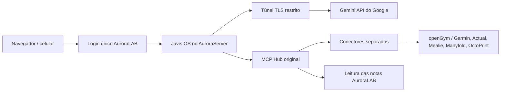

# Javis OS com Gemini no AuroraServer — 35.0.0

O Javis OS original 0.623.0 conversa com a Gemini API diretamente a partir do AuroraServer. O navegador, inclusive no celular com Tailscale, é apenas o cliente. Claude Desktop, Codex no PC e ponte SSH do Windows não são necessários para esta modalidade. O modelo Gemini é executado na nuvem do Google; interface, memória, notas e conectores ficam no servidor.

## Serviços

O overlay opcional `compose.javis.yaml` mantém `javis`, `javis-mcp`, `javis-fitness`, `javis-finance`, `javis-food` e `javis-print` e acrescenta `javis-ai-egress`. Javis e o túnel usam imagens 35.0.0; os conectores sem mudanças continuam na imagem 34.0.0. A versão upstream e o digest oficial continuam fixados em `source.lock.json`, com seis arquivos críticos conferidos antes de aplicar o adaptador AuroraLAB.

O Javis permanece na rede Docker interna. Somente o túnel participa também de uma rede com saída e aceita exclusivamente `CONNECT generativelanguage.googleapis.com:443`. Não termina TLS, não recebe a chave em texto aberto e não registra tráfego, cabeçalhos ou corpo. Outros destinos são recusados. `NO_PROXY` preserva o acesso ao conector MCP interno. Sem Docker socket, host networking ou nova porta pública.

`HTTPS_PROXY`/`HTTP_PROXY` apontam para esse túnel. A consulta de modelos foi adaptada para enviar a chave por `x-goog-api-key`, evitando credencial na URL ou em mensagens de erro. O motor de conversa, streaming e ciclo de ferramentas continuam sendo os nativos do Javis.

## Configuração da chave

1. Com Tailscale, entre no AuroraLAB como administrador protegido.
2. Abra `https://SEU-HOST-PRIVADO:7777/aurora-ai/setup`.
3. Cole a chave da Gemini API e escolha **Salvar chave e conferir conexão**. Não envie chaves pelo chat, GitHub ou URL.
4. A chave é guardada pelo cofre nativo do Javis, criptografada no volume de estado, e retirada do campo do navegador após o envio. Não é salva em localStorage. Somente o catálogo de modelos é consultado nessa etapa.
5. Selecione um modelo realmente disponível para o projeto em **Modelos do Javis**. A implantação validada usa `gemini-3.5-flash-lite`, com suporte a Free Tier conforme a tabela do Google na data da migração. Não reutilize modelos antigos apenas porque aparecem no fallback do upstream.
6. Abra `https://SEU-HOST-PRIVADO:7777/#p=chat`, recarregue a página e envie a mensagem.

Uma chave salva não é prova de autenticação válida. A confirmação exige catálogo retornado pelo Google com `live: true` e resposta real do motor. Chave inválida resulta em HTTP 400. Ausência de quota pode produzir HTTP 429; nenhum upgrade de faturamento é feito pela instalação. Cadastro de chave, seleção de modelo e projeto Free Tier são verificações diferentes. Disponibilidade e limites do Google podem mudar.

Não habilite faturamento por consequência de um erro de quota. Primeiro confira o projeto, elegibilidade, modelo e limites no Google AI Studio. O software não muda o plano do projeto e não promete custo zero caso o proprietário configure uma chave de projeto pago posteriormente. Sugestões automáticas de próximo prompt e tarefas autônomas devem permanecer desativadas para evitar chamadas que o usuário não solicitou.

## Dados e ferramentas

Sete consultas AuroraLAB: resumo de treinos openGym/Garmin, contas/categorias e totais do Actual, receitas e listas Mealie, estado OctoPrint e biblioteca Manyfold. As identidades e permissões atuais continuam sendo verificadas pelo autenticador a cada listagem/chamada.

O adaptador limita tanto a descoberta quanto o inventário e o despacho às sete ferramentas e três ferramentas nativas de leitura/pesquisa/listagem do vault `/brains/auroralab`. Usa o identificador nativo `fn`, preservando o prefixo `auroralab__`. Pedidos de escopo mais estreito são respeitados; plugins, diretórios de trabalho externos, staging e ferramentas de shell/escrita não ampliam esse conjunto. Conversa e grafo usam WebSocket autenticado; terminal e voz ao vivo ficam desativados nesta implantação.

O acesso aos dados dos aplicativos foi solicitado pelo proprietário. A IA consulta os aplicativos; gravações de lançamentos financeiros, alterações de receitas/treinos, exclusões e comandos de impressão não fazem parte desse catálogo. O administrador continua usando as interfaces dos aplicativos para essas ações. Não confunda acesso a todos os módulos conectados com autorização irrestrita de shell ou controle do Debian.

Os dados incluídos nas consultas e mensagens são enviados ao Google. No Free Tier, o Google informa uso de entradas/saídas para melhorar produtos e orienta não enviar dados pessoais, confidenciais ou sensíveis. Consulte os termos antes de decidir quais fontes disponibilizar. As credenciais dos aplicativos permanecem nos conectores; não são retornadas ao modelo. A chave Google fica fora do Git e de diagnósticos públicos.

## Backup e retorno

Estado e chave criptografada já pertencem ao backup privado do Javis; a chave de criptografia deve ser preservada junto desse estado. Configuração do túnel fica no Compose/código público, sem segredo próprio. O cache financeiro continua fora do backup. O serviço confiável de backup mantém a autorização específica de escrita no estado Javis para inicialização dos auxiliares SQLite/WAL; bancos de origem são abertos em leitura e arquivados por snapshots.

Antes da migração, faça backup com restauração isolada e preserve as configurações. Para retornar, restaure código/imagem/configuração anteriores do Javis, pare somente `javis-ai-egress` e retire o proxy do ambiente. Não execute `down -v` nem apague os dados dos aplicativos. A retirada da conexão antiga do Claude Desktop e da sua chave SSH restrita deve ser registrada separadamente; não desinstale o aplicativo pessoal Claude nem altere os outros conectores do usuário.

Os testes do módulo cobrem SSO, preservação de segredos, limites de consultas, filtro de ferramentas, namespace nativo e destino TLS. Use fixtures para testes de escrita e nunca bancos pessoais. As validações de implantação devem registrar apenas nomes de ferramentas, status, hashes e contagens, sem chaves ou conteúdo pessoal.

Fontes: [Javis OS](https://github.com/blogminhquy/javis-os), [chaves Gemini](https://ai.google.dev/gemini-api/docs/api-key), [preços e modelos](https://ai.google.dev/gemini-api/docs/pricing), [termos e tratamento de dados](https://ai.google.dev/gemini-api/terms). O modo anterior por Claude Desktop está documentado historicamente na [release 34](RELEASE-34.md).
